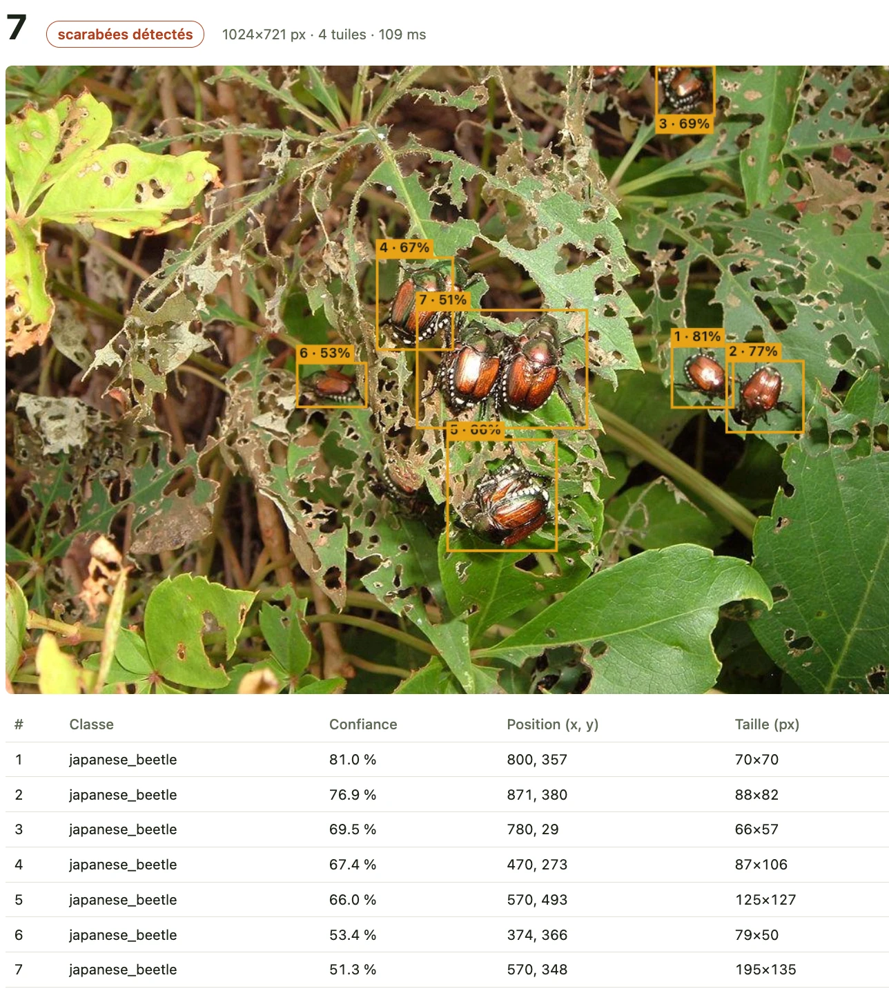
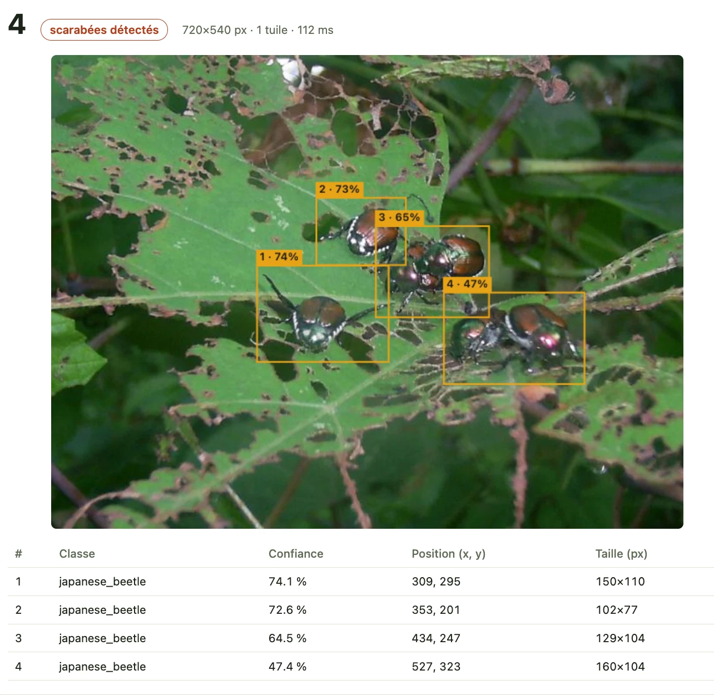
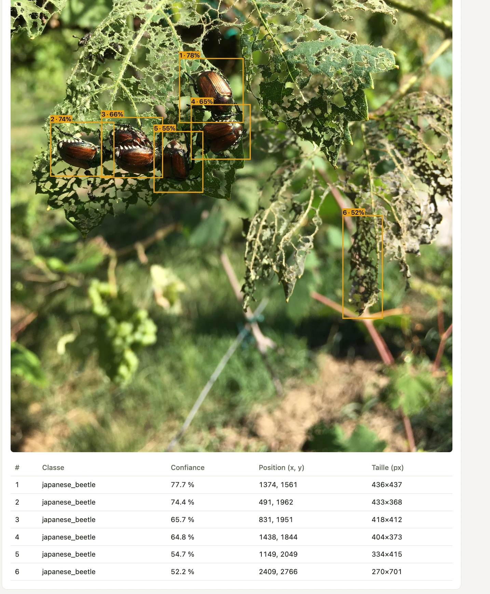
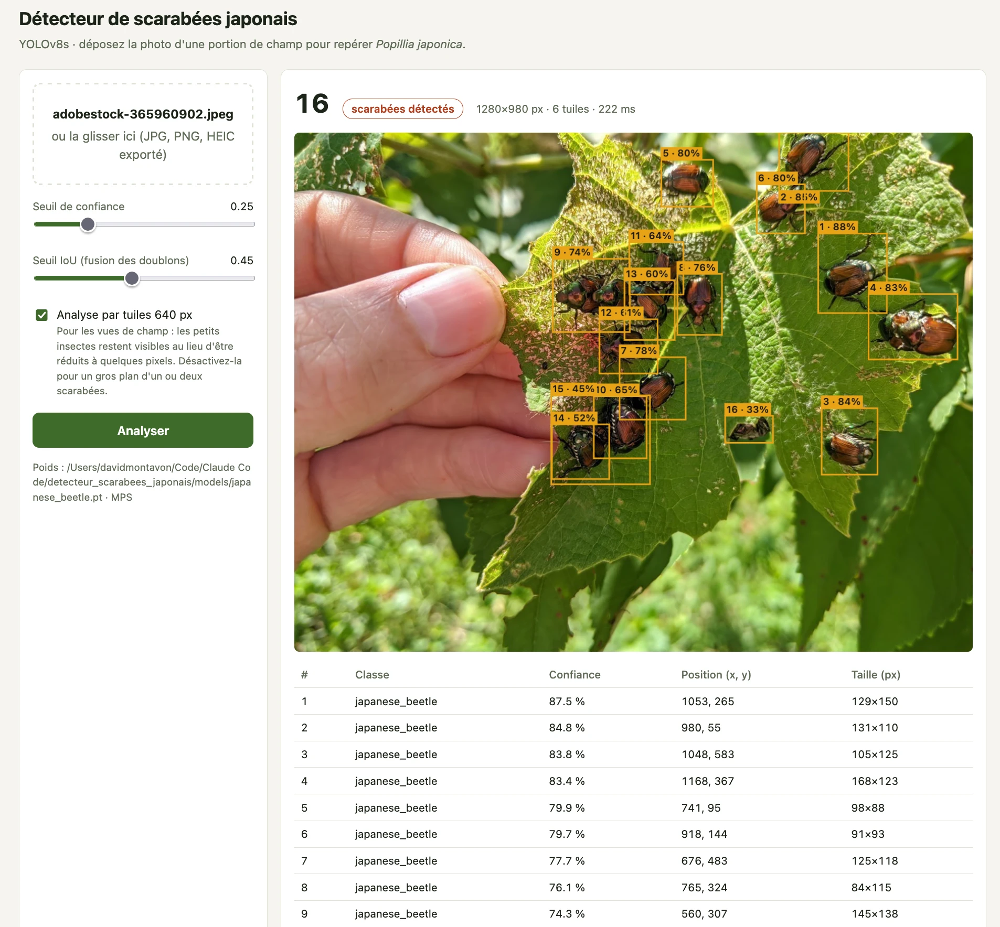

# Détecteur de scarabées japonais (YOLOv8s)

Web app qui détecte *Popillia japonica* sur la photo d'une portion de champ.

- **Backend** : FastAPI + Ultralytics YOLOv8s (`app.py`)
- **Frontend** : page unique sans dépendance (`static/index.html`) — glisser-déposer, seuils réglables, boîtes dessinées, tableau des détections
- **Inférence par tuiles** : les photos haute résolution sont découpées en tuiles 640 px qui se chevauchent (20 %), en plus d'une passe sur l'image entière. Les détections coupées par un bord de tuile et les fragments contenus dans une détection globale sont écartés. Indispensable pour des insectes d'environ 1 cm sur une photo de champ.

## Exemples

| | |
|---|---|
|  |  |
| **Feuillage dense** — 1024×721 px, 4 tuiles, 109 ms. 7 détections (51–81 %). | **Groupe sur une feuille** — 720×540 px, 1 tuile, 112 ms. 4 détections (47–74 %). |
|  |  |
| **Vigne** — 6 détections (52–78 %). | **Feuille tenue en main** — 1280×980 px, 6 tuiles, 222 ms. 16 détections (33–88 %). |

### Limites observées sur ces tests

- **Insectes agglutinés ou en accouplement** : deux scarabées collés sont parfois réunis dans une seule boîte (boîte 7 de la première image, boîte 4 de la deuxième). Le nombre affiché est alors un minimum.
- **Faux positif sur feuillage squelettisé** : sur la vigne, la boîte 6 (52 %) entoure une feuille sombre et dentelée, pas un insecte. Le relèvement du seuil ne suffit pas à l'écarter proprement : à 0,55, il supprimerait aussi la boîte 5 (55 %), qui est un vrai scarabée. Ajouter des photos de vigne abîmée sans scarabée à l'entraînement corrigerait ce cas.
- **Détections peu sûres** : en dessous d'environ 40 % (boîte 16 de la dernière image, 33 %), vérifier à l'œil.

## Performances du modèle

YOLOv8s fine-tuné 100 epochs sur 1 545 images (dont 20 % sans scarabée japonais : coccinelles, punaises, abeilles…).

| Jeu | Images | Précision | Rappel | mAP50 | mAP50-95 |
|---|---|---|---|---|---|
| Validation | 285 | 0,91 | 0,91 | 0,94 | 0,68 |
| Test (jamais vu) | 136 | 0,92 | 0,84 | 0,89 | 0,64 |

Ces images Roboflow sont surtout des gros plans : les scores sur des vues de champ plus larges peuvent être inférieurs. Ajouter ses propres photos annotées est le meilleur moyen de les améliorer.

## Installation

```bash
python3 -m venv .venv
.venv/bin/pip install -r requirements.txt
```

## Lancer l'app

```bash
.venv/bin/python -m uvicorn app:app --port 8000
```

Puis ouvrir http://localhost:8000.

## Important : il faut un modèle entraîné

YOLOv8s « de base » est entraîné sur COCO (80 classes : personne, voiture, chien…) et **ne connaît pas les scarabées japonais**. Sans poids spécifiques, l'app démarre en *mode démo* et l'indique.

1. Exporter au format **YOLOv8** (ZIP) les jeux Roboflow Universe suivants (CC BY 4.0) et les déposer dans `downloads/` :
   - [Japanese Beetle Identification](https://universe.roboflow.com/insect-identification-dgace/japanese-beetle-identification) — 1 091 images (pas de version publiée : « Fork Dataset », générer une version, puis exporter)
   - [InsectDetectionV2](https://universe.roboflow.com/cool-internship/insectdetectionv2) — 537 images, 10 insectes
   - [pest-demo](https://universe.roboflow.com/aditya-sengupta/pest-demo) — 156 images, 4 ravageurs

   Vos propres photos annotées (export YOLO) peuvent aussi y aller.
2. Fusionner en un jeu mono-classe (les autres insectes deviennent des exemples négatifs) :
   ```bash
   .venv/bin/python merge_datasets.py
   ```
3. Entraîner :
   ```bash
   .venv/bin/python train.py --epochs 100
   ```
   Le meilleur modèle est copié dans `models/japanese_beetle.pt` et chargé automatiquement au prochain démarrage. On peut aussi pointer vers d'autres poids : `BEETLE_WEIGHTS=/chemin/best.pt`.

Sur un Mac Apple Silicon, l'entraînement et l'inférence utilisent le GPU via MPS.

## API

`POST /api/detect` (multipart) : `file`, `conf` (0.25), `iou` (0.45), `tiled` (true)
→ `{count, detections:[{box:[x1,y1,x2,y2], score, label}], width, height, tiles, inference_ms, demo_mode}`

`GET /api/info` → poids chargés, classes, appareil, mode démo.
